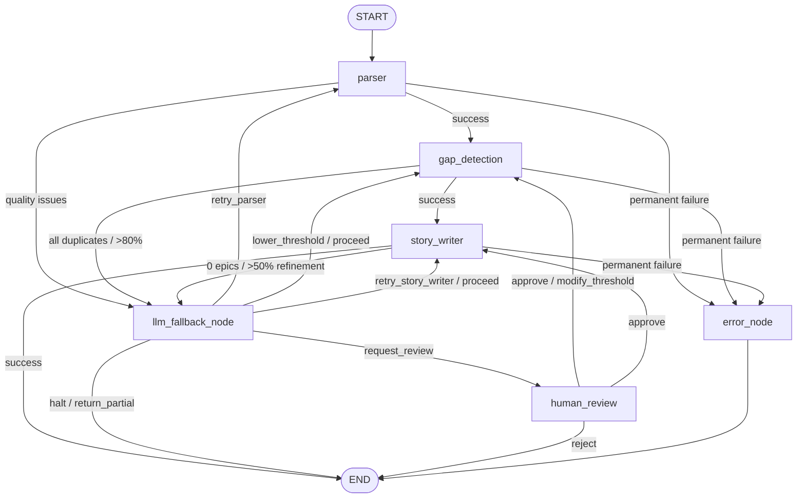

# Backlog Synthesizer — LangGraph Migration

A multi-agent pipeline that reads meeting transcripts and architecture documents, compares extracted items against an existing backlog, and produces structured user stories grouped into epics.

This is a **LangGraph migration** of the [original Backlog Synthesizer](https://github.com/AnshulRehpade/backlog-synthesizer). The hand-rolled orchestrator has been replaced with LangGraph's `StateGraph`, gaining built-in checkpointing, conditional routing, time-travel debugging, and human-in-the-loop support.

## Graph Topology



## Three-Tier Decision Pattern

| Level | Mechanism | Cost | When |
|-------|-----------|------|------|
| 1 | Conditional edges | Zero | Normal routing (parser → gap → story) |
| 2 | LLM fallback node | 1 LLM call | Unexpected situations (0 items, all duplicates) |
| 3 | Human review node | Interrupt | Critical decisions requiring human judgment |

## Quick Start

```bash
# Clone and setup
git clone <repo-url>
cd Backlog_Synthesizer_LangGraph
python3 -m venv .venv
source .venv/bin/activate
pip install -e ".[dev]"

# Configure
cp .env.example .env
# Edit .env and add your ANTHROPIC_API_KEY

# Run the pipeline
python main.py data/sample_transcript.txt --backlog data/sample_backlog.json

# Run tests
python -m pytest tests/
```

## Running the Demo

```bash
# Basic run with just a transcript
python main.py data/sample_transcript.txt

# Full run with existing backlog for duplicate detection
python main.py data/sample_transcript.txt --backlog data/sample_backlog.json
```

The pipeline will:
1. Parse the transcript and extract actionable items (features, pain points, decisions)
2. Compare extracted items against existing backlog tickets via semantic search
3. Generate structured user stories with acceptance criteria for new/conflicting items
4. Output epics grouped by shared tags

## Running Tests

```bash
# Run all tests with coverage (auto-configured via pyproject.toml)
python -m pytest tests/

# Run with verbose output
python -m pytest tests/ -v

# Run a specific test file
python -m pytest tests/test_parser_node.py

# Run with coverage threshold enforcement
python -m pytest tests/ --cov-fail-under=65
```

## Project Structure

```
graph/          — LangGraph infrastructure (state, builder, routing, checkpointer)
nodes/          — Node functions (parser, gap_detection, story_writer, llm_fallback, human_review, error)
src/            — Agent implementations, tools, models, memory, observability
tests/          — 110 tests across 6 test files
data/           — Sample transcript and backlog for demo
main.py         — CLI entry point
```

## Key Differences from Original

| Aspect | Original | LangGraph Migration |
|--------|----------|-------------------|
| Orchestration | Hand-rolled `Orchestrator` class | LangGraph `StateGraph` with conditional edges |
| Short-term memory | Custom `ShortTermMemory` with dict fallback | LangGraph `Checkpointer` (MemorySaver / SqliteSaver) |
| Retry logic | Internal function calls in orchestrator | Graph cycles via `route_after_llm_fallback` edges |
| Decision making | 5 ReAct LLM calls at every decision point | Three-tier: deterministic edges → LLM fallback → human review |
| Human review | Not supported | `interrupt()` pauses graph, resumes on human input |
| State persistence | Manual session store | Automatic after every node via checkpointer |
| Replay/debugging | Not supported | Time-travel via checkpointer history |

## What Stayed the Same

- All tool implementations (Anthropic, OpenAI, embeddings, vector search, PDF parsing)
- All Protocol interfaces (`tools/interfaces.py`)
- All Pydantic models (inputs, extraction, gap_detection, output, memory)
- Long-Term Memory (ChromaDB vector store)
- Audit Log (chronological invocation records)
- OpenTelemetry observability layer
- Configuration via environment variables (`PipelineConfig`)
- Error taxonomy (`ToolError` → `TransientToolError` | `PermanentToolError`)

## Environment Variables

See [`.env.example`](.env.example) for the full list. Key variables:

| Variable | Default | Description |
|----------|---------|-------------|
| `LLM_PROVIDER` | `anthropic` | LLM provider (`anthropic` or `openai`) |
| `ANTHROPIC_API_KEY` | — | Required for Anthropic provider |
| `ANTHROPIC_MODEL` | `claude-haiku-4-5-20251001` | Model for extraction and decisions |
| `GAP_DETECTION_DUPLICATE_THRESHOLD` | `0.80` | Similarity score for duplicate detection |
| `GAP_DETECTION_CONFLICT_THRESHOLD` | `0.50` | Similarity score for conflict detection |
| `OTEL_ENABLED` | `true` | Enable OpenTelemetry tracing |

## License

MIT
