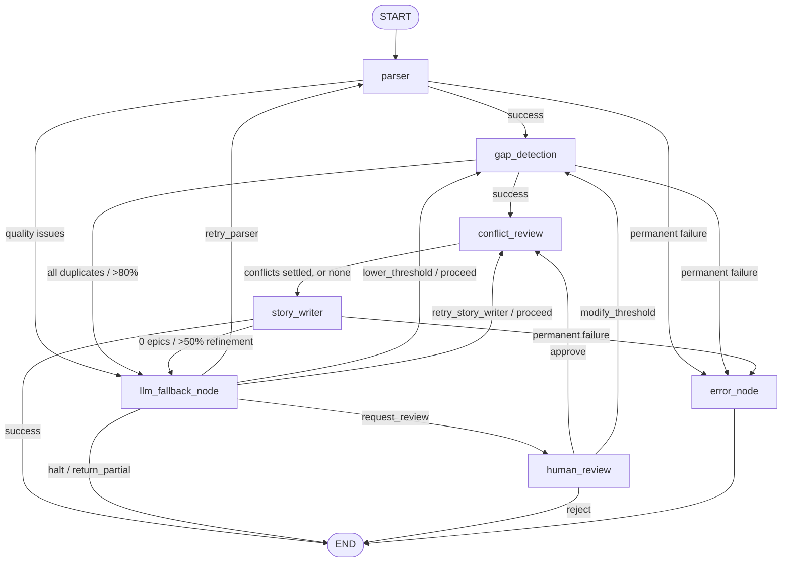

# Backlog Synthesizer — LangGraph Migration

A multi-agent pipeline that reads meeting transcripts and architecture documents, compares extracted items against an existing backlog, and produces structured user stories grouped into epics, each linked to the ticket it changes or builds on.

> **Reviewers:** see [DESIGN_NOTES.md](DESIGN_NOTES.md) for who it's for, the key design decision and its tradeoff, and how it's tested and evaluated.

This is a **LangGraph migration** of the [original Backlog Synthesizer](https://github.com/AnshulRehpade/backlog-synthesizer). The hand-rolled orchestrator has been replaced with LangGraph's `StateGraph`, gaining built-in checkpointing, conditional routing, time-travel debugging, and human-in-the-loop support.

## Graph Topology



Every route into `story_writer` passes through `conflict_review`, which pauses only when there are unresolved conflicts.

## Three-Tier Decision Pattern

| Level | Mechanism | Cost | When |
|-------|-----------|------|------|
| 1 | Conditional edges | Zero | Normal routing (parser → gap → story) |
| 2 | LLM fallback node | 1 LLM call (opt-in agent: a few) | Unexpected situations (0 items, all duplicates) |
| 3 | Human review (`interrupt()`) | A person's time | Conflicts with existing tickets, and fallback cases that need judgment |

**Level 2 agent (opt-in).** With `FALLBACK_MODE=agent`, a bounded tool-calling agent investigates before choosing (lists matches, reads tickets, asks the judge, corrects labels) within 6 turns and 30k tokens, falling back to the single call if it can't decide. Measured against the single call it made the same decisions at higher cost, so it isn't the default — see [evaluation/agent_vs_menu.md](evaluation/agent_vs_menu.md).

## How It Works

1. **Parse.** The transcript is read in one piece (12,000-character chunks) at temperature 0 and split into feature requests, pain points, decisions and constraints. Talk about the meeting itself (agenda, sizing, prioritizing, recaps) is labeled `meeting_note` and set aside.
2. **Detect gaps.** Each item is matched against the current backlog by embedding similarity. Any match scoring 0.30 or more goes to an LLM judge that answers:

   | Verdict | Meaning | Result |
   |---|---|---|
   | duplicate | Already covered by the ticket | No story |
   | conflict | Changes or contradicts what the ticket specifies | Human review |
   | related | Same area: follow-on work, an addition, or a bug report | Story linked to the ticket, no review |
   | unrelated | Only shares vocabulary | New story |

   For conflicts the judge also suggests a resolution: **meeting wins** (the story replaces the ticket), **keep the ticket** (no story), or **keep both**.
3. **Group the work.** One LLM call groups items that are the same piece of work (a problem and its fix, a request said twice), so each piece of work becomes one story.
4. **Review conflicts.** The run pauses once with every conflict on one screen, grouped by ticket, each pre-set to the judge's suggestion. "Accept all" settles them in one click. With review off (`CONFLICT_REVIEW=false`), the suggestions are applied.
5. **Write stories.** One story per piece of work, with acceptance criteria and tags, grouped into epics. Each story records the ticket it `replaces`, `relates_to`, or sits `alongside`, and the exports carry that link.

## Quick Start

```bash
# Clone and setup
git clone https://github.com/AnshulRehpade/Backlog_Synthesizer_LangGraph.git
cd Backlog_Synthesizer_LangGraph
python3 -m venv .venv
source .venv/bin/activate
pip install -e ".[dev]"

# Configure
cp .env.example .env
# Edit .env and add your ANTHROPIC_API_KEY

# Run the pipeline
python main.py data/sample_transcript.txt --backlog data/sample_backlog.json

# Run tests
python -m pytest tests/
```

## Streamlit UI

```bash
streamlit run app.py
```

Opens a web UI at http://localhost:8501 with:
- Sidebar for transcript upload/paste (sample pre-filled), backlog input, and threshold sliders
- Live pipeline progress for each agent step
- **Conflict review:** one screen with every conflict, grouped by ticket, suggestions preselected; *Accept all suggestions* or *Apply my choices*
- **Human review:** Approve / Reject / Re-run gap detection with a new threshold, when the fallback asks for a person
- Results in tabs: Stories (each with its 🔗 ticket link), Pipeline Stats, Raw JSON, Audit Log
- Exports: JSON, JIRA CSV (with *Linked Issue* and *Link Type* columns), GitHub Issues markdown

## Running the Demo (CLI)

```bash
# Basic run with just a transcript
python main.py data/sample_transcript.txt

# Full run with existing backlog for duplicate and conflict detection
python main.py data/sample_transcript.txt --backlog data/sample_backlog.json
```

When a run pauses, the CLI asks at the terminal: conflicts are listed by ticket with their suggested resolution (press Enter to accept them all), and a human-review pause asks for approve / reject / modify_threshold. Without a terminal it accepts the conflict suggestions and rejects a human-review pause.

## Evaluation

Each part of the pipeline has its own scored check against labeled data:

| Script | What it checks | Data |
|---|---|---|
| `evaluation/run_eval.py` | Full pipeline: story count (±1), duplicate and conflict counts exactly | `golden_dataset.json` (8 transcripts) |
| `evaluation/run_gap_eval.py` | Gap verdicts, conflicts caught, false alarms, ticket links, resolutions, and work grouping | `gap_labels.json` (20 items from the sample meeting) |
| `evaluation/run_suggestion_eval.py` | The judge's suggested conflict resolutions | `conflict_suggestions.json` (7 real conflicts) |
| `run_eval.py --fallback-mode agent\|menu` | The opt-in fallback agent vs. the single call | results in `agent_vs_menu.md` |
| `evaluation/run_holdout_eval.py` | Full pipeline on 3 meetings never used for tuning: stories per piece of work, extra stories, ticket links, conflicts and resolutions; `--repo` runs an older checkout for before/after | `holdout/answer_key.json`, results in `holdout/RESULTS.md` |

```bash
python evaluation/run_eval.py --verbose
python evaluation/run_gap_eval.py
```

These call the real LLM, so they need an API key and cost a little to run. The golden eval runs with conflict review off.

## Running Tests

```bash
# Run all tests with coverage (auto-configured via pyproject.toml)
python -m pytest tests/

# Run with verbose output
python -m pytest tests/ -v

# Run a specific test file (add --no-cov, or the 70% coverage minimum fails a partial run)
python -m pytest tests/test_parser_node.py --no-cov
```

Every full run reports coverage and fails below 70% (set in `pyproject.toml`).

Tests make no API calls: LLMs are mocked, and `tests/conftest.py` keeps the fallback on the single-call menu.

## Project Structure

```
graph/          — LangGraph infrastructure (state, builder, routing, checkpointer, review helpers)
nodes/          — Node functions (parser, gap_detection, conflict_review, story_writer, llm_fallback, human_review, error)
src/            — Agent implementations (incl. work grouping and the fallback agent), tools, models, memory, observability
evaluation/     — Scored evaluations, labeled data, and results
tests/          — 260 tests across 17 test files
data/           — Sample transcript and backlog for demo
app.py          — Streamlit web UI
main.py         — CLI entry point
```

## Key Differences from Original

| Aspect | Original | LangGraph Migration |
|--------|----------|-------------------|
| Orchestration | Hand-rolled `Orchestrator` class | LangGraph `StateGraph` with conditional edges |
| Short-term memory | Custom `ShortTermMemory` with dict fallback | LangGraph `Checkpointer` (MemorySaver / SqliteSaver) |
| Retry logic | Internal function calls in orchestrator | Graph cycles via `route_after_llm_fallback` edges |
| Decision making | 5 ReAct LLM calls at every decision point | Three-tier: deterministic edges → LLM fallback → human review |
| Human review | Not supported | `interrupt()` pauses graph, resumes on human input |
| Conflicts | Flagged by similarity threshold | Judged by an LLM, settled by a person on one review screen |
| Stories | One per extracted item | One per piece of work, linked to the ticket it changes |
| State persistence | Manual session store | Automatic after every node via checkpointer |
| Replay/debugging | Not supported | Time-travel via checkpointer history |

## Carried Over from the Original

These were brought over from the original project; several have since been extended (for example, the LLM tools gained a `temperature` setting and tool calling, and the models gained the `related` verdict and story ticket links):

- All tool implementations (Anthropic, OpenAI, embeddings, vector search, PDF parsing)
- All Protocol interfaces (`tools/interfaces.py`)
- The Pydantic models (inputs, extraction, gap_detection, output, memory)
- Long-Term Memory (ChromaDB vector store)
- Audit Log (chronological invocation records)
- OpenTelemetry observability layer
- Configuration via environment variables (`PipelineConfig`)
- Error taxonomy (`ToolError` → `TransientToolError` | `PermanentToolError`)

## Environment Variables

See [`.env.example`](.env.example) for the full list. Key variables:

| Variable | Default | Description |
|----------|---------|-------------|
| `LLM_PROVIDER` | `anthropic` | LLM provider (`anthropic` or `openai`) |
| `ANTHROPIC_API_KEY` | — | Required for Anthropic provider |
| `ANTHROPIC_MODEL` | `claude-haiku-4-5-20251001` | Model for extraction and decisions |
| `GAP_DETECTION_DUPLICATE_THRESHOLD` | `0.80` | Similarity for duplicates when no LLM judge is available |
| `GAP_DETECTION_CONFLICT_THRESHOLD` | `0.50` | Similarity for conflicts when no LLM judge is available |
| `GAP_DETECTION_VERIFY_THRESHOLD` | `0.30` | With an LLM judge, matches at or above this are judged |
| `CONFLICT_REVIEW` | `true` | Pause for a person to settle conflicts; `false` applies the judge's suggestions |
| `FALLBACK_MODE` | `menu` | `menu` = one LLM call; `agent` = opt-in tool-calling fallback agent |
| `OTEL_ENABLED` | `true` | Enable OpenTelemetry tracing |

## License

MIT
